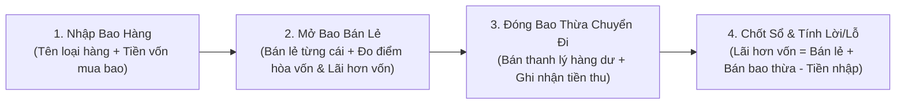

# KẾ HOẠCH & QUY ĐỊNH DỰ ÁN: QUẢN LÝ BÁN QUẦN ÁO THEO BAO (BanHangChuNgoc)

> **Mục tiêu**: Xây dựng phần mềm quản lý bán quần áo theo kiện/bao hàng cho Chú Ngọc, tinh gọn, dễ dùng cho 1 người, trực quan, kiểm soát chính xác dòng tiền vốn - thu bán lẻ - thu thanh lý bao thừa - điểm hòa vốn và số tiền lãi hơn vốn.

---

## 1. Bản Chất Nghiệp Vụ Cửa Hàng Chú Ngọc

Cửa hàng hoạt động theo chu trình vòng đời của từng **Bao Hàng (Kiện/Thùng Hàng)**:

### Chi tiết các bước nghiệp vụ:
1. **Quy chuẩn đơn vị tiền tệ (Rút gọn trừ 3 số 0)**:
   - **Tất cả các số tiền nhập và hiển thị trên toàn dự án đều dùng đơn vị nghìn đồng (`k`)**.
   - Ví dụ: 
     - `1.000.000 đ` ➔ Ghi và hiển thị là `1000` (hoặc `1,000 k`).
     - `30.000 đ` ➔ Ghi và hiển thị là `30` (hoặc `30 k`).
     - `4.500.000 đ` ➔ Ghi và hiển thị là `4500` (hoặc `4,500 k`).
   - Giúp việc gõ phím nhanh gấp nhiều lần, không bị nhầm lẫn số lượng số 0.
2. **Nhập bao hàng**: Nhập tên/loại hàng (VD: *Bao áo gió Hàn Quốc*, *Bao áo thun Mỹ*...) và số tiền vốn bỏ ra cho bao đó (`TienNhap` tính theo k, ví dụ 4500). Không cần đếm số áo khi nhập.
3. **Bán lẻ từng cái áo**:
   - Lấy áo trong bao ra bán lẻ từng cái.
   - Không cần đặt tên cho từng cái áo.
   - Chỉ cần gõ đơn giá (đơn vị k, ví dụ: 30, 50, 80, 120...) rồi bấm **ENTER** để lưu ngay lượt bán.
4. **Theo dõi Điểm hòa vốn & LÃI HƠN BAO NHIÊU**:
   - **🎯 Đồng hồ đo điểm hòa vốn (Break-even Meter)**: Hiển thị thanh tiến độ % vốn đã thu hồi.
   - **Khi chưa đủ vốn**: Hiển thị màu vàng cam, báo rõ còn thiếu bao nhiêu k nữa là hòa vốn.
   - **Khi đã hòa vốn & sinh lời**: Đổi sang màu xanh ngọc lục bảo rực rỡ, báo rõ ràng **LÃI HƠN TIỀN VỐN: +... k (+...%)**.
5. **Xử lý hàng thừa (Đóng bao chuyển đi)**:
   - Khi đã bán lẻ được phần lớn áo, số quần áo còn dư đóng bao tải lại chuyển đi bán buôn/thanh lý.
   - Ghi nhận số tiền bán được từ bao thừa đó (`TienBanThua` tính theo k, ví dụ 800) và ngày kết thúc (`NgayKetThuc`).
6. **Quản lý dòng tiền & Lời/Lỗ**:
   - **Tổng tiền thu từ 1 bao** = Tổng tiền bán lẻ các cái áo + Tiền bán bao thừa.
   - **Lợi nhuận (Lãi hơn vốn)** = Tổng tiền thu - Tiền vốn nhập bao.

---

## 2. Tiêu Chuẩn Công Nghệ & Quy Tắc Lập Trình

- **Ngôn ngữ & Nền tảng**: C# (.NET 9), Windows Presentation Foundation (WPF).
- **Mô hình kiến trúc**: **MVVM (Model - View - ViewModel)** dùng `CommunityToolkit.Mvvm`.
- **Hệ cơ sở dữ liệu**: Microsoft SQL Server (MSSQL), kết nối thông qua script [database.sql](file:///c:/Users/Admin/Contacts/Desktop/BanHangChuNgoc/BanHangChuNgoc/database.sql).
- **Quy tắc thiết kế code**:
  - Dễ bảo trì, phân tách rõ ràng:
    - `Models/`: Ánh xạ bảng `BaoHang`, `BanLe`, `ThongKeBaoHang` theo đơn vị k.
    - `ViewModels/`: `MainViewModel.cs` xử lý tính toán điểm hòa vốn, số tiền lãi hơn vốn, thêm/xóa lượt bán lẻ, chốt sổ.
    - `Views/`: `MainWindow.xaml` trực quan, hiện đại, hỗ trợ phím Enter bán hàng tức thì.
    - `Services/`: `DatabaseService.cs` kết nối và truy vấn MSSQL.
    - `Helpers/`: `CurrencyConverter` tự động format thêm hậu tố ` k`.
  - **Quy chuẩn hiển thị**: Tự động phóng to toàn màn hình (`WindowState="Maximized"`) kèm đầy đủ cụm 3 nút cửa sổ (Thu nhỏ, Phóng to/Khôi phục, Đóng).
  - **Tối ưu thao tác bán hàng**: Khi click chuột hoặc focus vào bất kỳ ô nhập liệu nào (`TextBox`), hệ thống tự động bôi đen toàn bộ ký tự có sẵn để Chú chỉ việc gõ số mới, không cần ấn nút xóa.

---

## 3. Danh Sách Các Chức Năng Đã Triển Khai

| STT | Phân hệ (Module) | Mô tả chi tiết | Trạng thái |
|:---:|:---|:---|:---:|
| 1 | **Quy Chuẩn Tiền Tệ Rút Gọn (Trừ 3 số 0)** | Thống nhất toàn bộ dự án từ CSDL, Form nhập đến Báo cáo: 1 triệu ghi 1000, 30 nghìn ghi 30. | ✅ Đã hoàn thành |
| 2 | **Quản lý Nhập Bao Hàng** | Thêm bao mới (Tên bao, Tiền vốn k, Ngày nhập, Ghi chú), danh sách bao đang bán và đã kết thúc. | ✅ Đã hoàn thành |
| 3 | **Bán Lẻ Áo Từng Cái** | Nhập đơn giá bán ra từng cái áo (k), ô số lượng, phím tắt Enter bán ngay cực nhanh (1 giây/áo), danh sách áo đã bán, xóa lượt bán khi nhập nhầm. | ✅ Đã hoàn thành |
| 4 | **🎯 Đồng Hồ Đo Hòa Vốn & LÃI HƠN VỐN** | Thanh `Break-even Meter` tự động tính % thu hồi vốn. Khi chưa đủ vốn: báo thiếu bao nhiêu k. Khi đủ vốn: báo xanh lá '🎉 ĐÃ HÒA VỐN! LÃI HƠN TIỀN VỐN: +... k (+...%)'. | ✅ Đã hoàn thành |
| 5 | **Chốt Sổ & Bán Bao Thừa** | Nhập số tiền thanh lý bao thừa (k), ngày chốt sổ, cập nhật trạng thái 'Đã kết thúc', hiển thị tổng kết chi tiết Vốn - Thu bán lẻ - Thu bao thừa - LÃI HƠN VỐN. | ✅ Đã hoàn thành |
| 6 | **Báo Cáo & Dòng Tiền** | Lọc theo **Tháng** và **Năm** (không cần lọc theo ngày), 4 thẻ KPI tổng (Tổng vốn k, Tổng thu lẻ k, Tổng thu thừa k, Tổng lãi ròng k), bảng chi tiết tiến độ và hiệu quả từng bao kèm % Lãi/Lỗ. | ✅ Đã hoàn thành |
| 7 | **Đăng Nhập Hệ Thống (Login)** | Màn hình đăng nhập tài khoản/mật khẩu, đọc ghi thông tin cố định qua file [taikhoan.json](file:///c:/Users/Admin/Contacts/Desktop/BanHangChuNgoc/BanHangChuNgoc/taikhoan.json) (`TK: NgocMai`, `MK: NgocMai`). | ✅ Đã hoàn thành |

---

## 4. Nhật Ký Tiến Độ (Change Log)
- **2026-10-11 (Giai đoạn 1)**: Khởi tạo dự án WPF C# .NET 9 MVVM kết nối SQL Server.
- **2026-10-11 (Giai đoạn 2)**: Thêm Đồng hồ đo điểm hòa vốn (Break-even Meter).
- **2026-10-11 (Giai đoạn 3)**: Xóa bỏ ước tính số áo, làm nổi bật chỉ số LÃI HƠN TIỀN VỐN (VNĐ và %).
- **2026-10-11 (Giai đoạn 4)**: 
  - **Chuẩn hóa toàn bộ hệ thống tiền tệ sang đơn vị trừ 3 số 0 (`k`)**: 1 triệu = 1000, 30 nghìn = 30 trên Database, Models, ViewModels và Giao diện UI.
  - Tự động bôi đen toàn bộ chữ/số khi focus/click vào ô nhập liệu (`TextBox`).
  - Mở ứng dụng tự động toàn màn hình (`WindowState="Maximized"`).
  - Tối ưu giao diện: Xóa bỏ các tab và hướng dẫn thừa, giữ giao diện sạch sẽ, chuyên nghiệp.
- **2026-10-11 (Giai đoạn 5)**: 
  - **Đổi bộ lọc báo cáo**: Chuyển từ lọc theo ngày sang lọc linh hoạt theo **Tháng** (`Tháng 1` - `Tháng 12` / `Tất cả`) và **Năm** (`2024` - `2030` / `Tất cả`). Cho phép chọn trong danh sách hoặc gõ trực tiếp bất kỳ năm nào.
- **2026-10-11 (Giai đoạn 6)**: 
  - **Màn hình Đăng Nhập (Login)**: Khởi chạy trước khi vào giao diện chính. Đọc tài khoản & mật khẩu từ file [taikhoan.json](file:///c:/Users/Admin/Contacts/Desktop/BanHangChuNgoc/BanHangChuNgoc/taikhoan.json) (`TK: NgocMai`, `MK: NgocMai`). Có thông báo lỗi khi nhập sai, hỗ trợ phím Enter chuyển ô và đăng nhập tức thì.
- **2026-10-11 (Giai đoạn 7)**: 
  - **Chuyển vị trí nút Xóa bao hàng**: Bỏ nút Xóa ở thẻ bao hàng bên Tab 1 (Bán hàng) để tránh bấm nhầm khi đang thao tác. Đưa nút **Xóa** thành một cột riêng (`Thao tác`) trong **Bảng chi tiết từng bao hàng** ở Tab 2 (Báo Cáo & Dòng Tiền) có hộp thoại xác nhận an toàn trước khi xóa.
